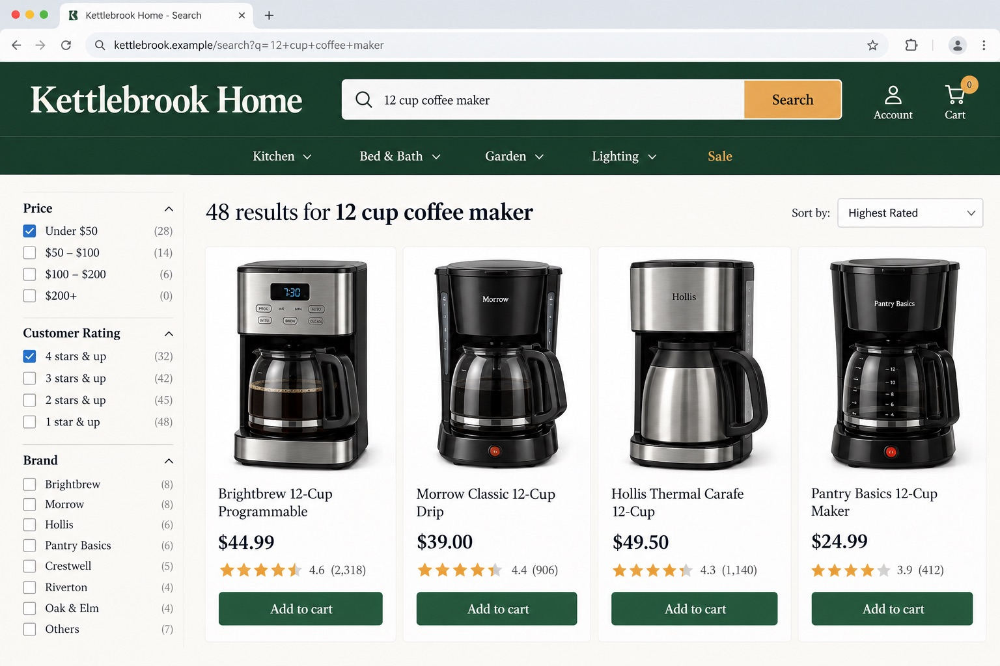
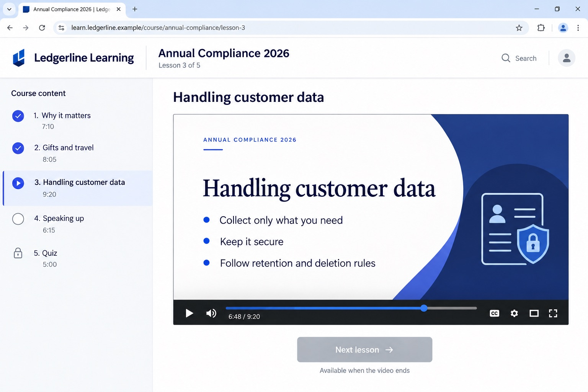
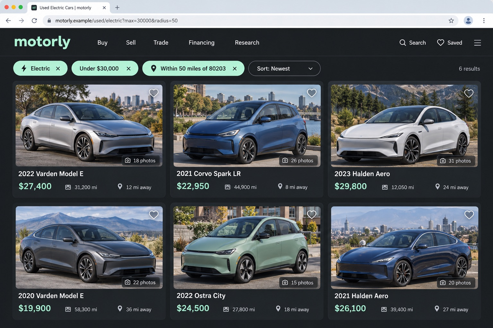
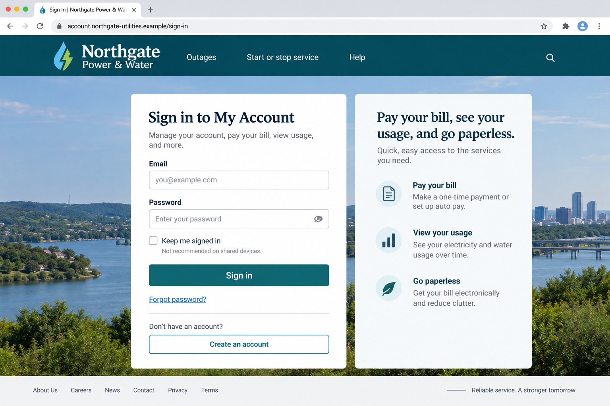
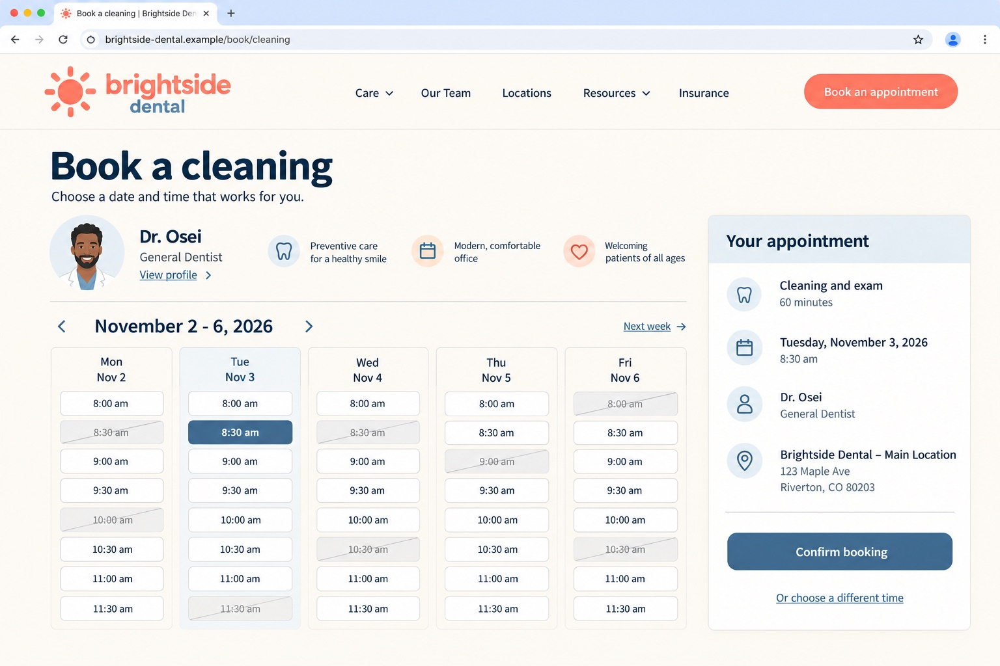
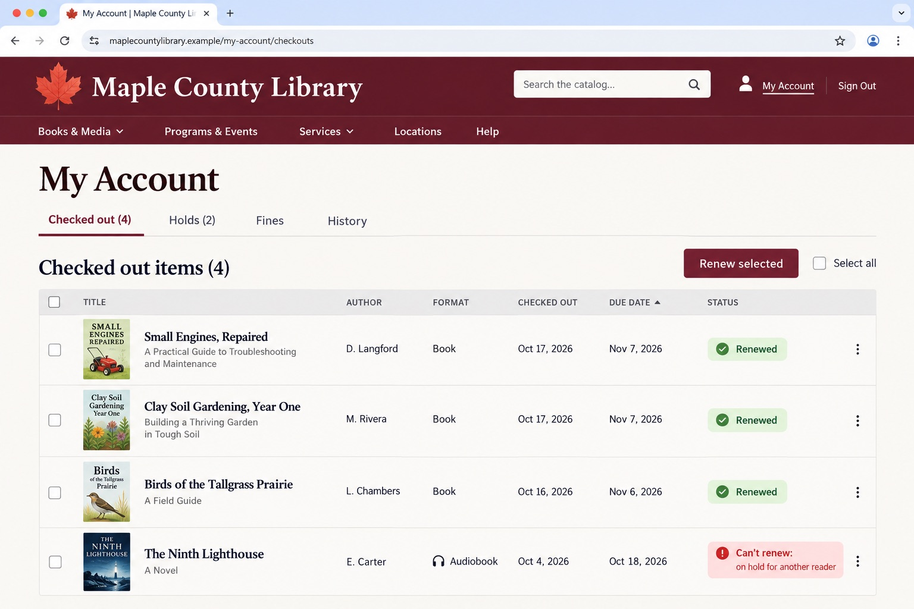

# Homebrowser

A browser for your AI agent that websites don't block, and that stays logged in. It runs in a container on your own computer, and you can watch it or take over from your phone.



> **You:** *"With Homebrowser, find a 12-cup coffee maker under $50 with good reviews and put the best one in my cart."*
>
> **Homebrowser:** Added the Brightbrew 12-Cup Programmable, $44.99, 4.6 stars from 2,318 reviews: the best-rated maker under $50.

## What you can hand it

Ask your agent to do things on websites "with Homebrowser". It opens a real browser on your computer, finds its way around each site the way a person would, and tells your agent what it found or did. Some examples, on made-up sites:

<table>
<tr>
<td width="50%" valign="top">


**Training.** *"Work through my assigned compliance course. Stop when you reach a quiz."*

Follows the course player into its pop-up window, waits out each video until **Next** unlocks, and hands you the quiz: *Finished lessons 1 to 4 (38 minutes of video). The lesson 5 quiz is ready for you.*
</td>
<td width="50%" valign="top">


**Shopping around.** *"Find used electric cars under $30,000 within 50 miles and save the photos of each."*

Reads every listing and saves the photos: *9 listings, 214 photos saved to `~/.homebrowser/data/images/`, with a summary of each car.*
</td>
</tr>
<tr>
<td width="50%" valign="top">


**Paperwork.** *"Download my last 12 power bills as PDFs."*

Stops at the sign-in page and your agent sends you a link. You sign in from your phone, tap **Done, carry on**, and it saves all 12.
</td>
<td width="50%" valign="top">


**Appointments.** *"Book my next cleaning on the earliest Tuesday morning."*

Works the calendar and the form: *Booked Tuesday, November 3 at 8:30 am with Dr. Osei. The confirmation is in your email.*
</td>
</tr>
<tr>
<td width="50%" valign="top">


**Errands.** *"Renew my library books that are due this week."*

Does what it can and says what it couldn't: *Renewed 3 of 4. The Ninth Lighthouse has a hold on it, so it's due back Sunday, October 18.*
</td>
<td width="50%" valign="top">

**And the rest of your list.**

- *"Tell me if Denver to Lisbon in May drops under $700."*
- *"A table for 4 on Friday at 7, somewhere quiet."*
- *"Renew my parking permit."*
- *"Download my last three pay stubs."*
- *"Is anything I ordered still on its way?"*

Anything you'd do in a browser yourself. It keeps notes on each site it visits, so the next run starts out knowing where things are.
</td>
</tr>
</table>

## Watch it, or step in

Ask your agent to share the Homebrowser console. It's a private link that works from your phone or any computer, behind a password you choose. In the console you can:

- see every session and what it's doing right now,
- watch the live browser, type a new address, or take over the mouse,
- sign in to a site yourself, then tap **Done, carry on**,
- send a session a message, or stop it.

## Install

Tell your agent (Claude Code, Codex, Cursor, Grok, and so on):

```text
Install Homebrowser from https://github.com/jonclegg/homebrowser
```

That's it. Your agent will:

1. **Install Homebrowser** on your Mac, Linux, or Windows computer.
2. **Ask before installing Docker**, if your computer doesn't have it yet.
3. **Open a page for your OpenRouter key.** Homebrowser's built-in agent uses it to drive the browser. You paste the key into that page on your own computer, never into the chat. Get one at [openrouter.ai/keys](https://openrouter.ai/keys).
4. **Prove it works.** Your agent asks which two or three sites you use, and Homebrowser visits them the way a person would and shows you a screenshot of each.

## Good to know

- **Sign in yourself.** When a site needs a password, Homebrowser stops and your agent sends you the console link, so you can sign in from your phone or any computer. Don't paste passwords into the chat. Your agent can type in texted sign-in codes for you.
- **It runs on your computer.** Traffic leaves from your own internet connection. Nothing is reachable from outside unless you share the console, and the console asks for your password.
- **The details** for agents and the curious are in [AGENTS.md](AGENTS.md) and [the agent guide](skills/homebrowser/SKILL.md). The browser is Chromium with [Fury](https://github.com/furyteamtop/fury-antidetect-browser)'s fingerprint patches, built for Linux from [`browser/`](browser).

## License

Homebrowser's own code is [MIT licensed](LICENSE). The browser is Chromium (BSD-3-Clause) with Fury's patches (BSD-3-Clause); see [NOTICE](NOTICE) for every component's license. Homebrowser is an independent project, not affiliated with the Fury authors or any website it visits. The sites in this README are made up, and their pictures are illustrations.
