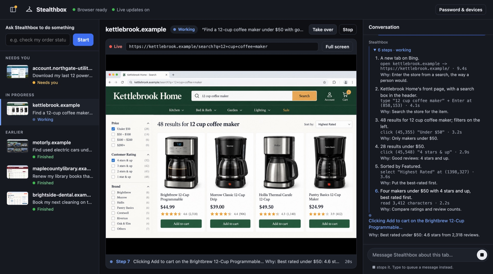
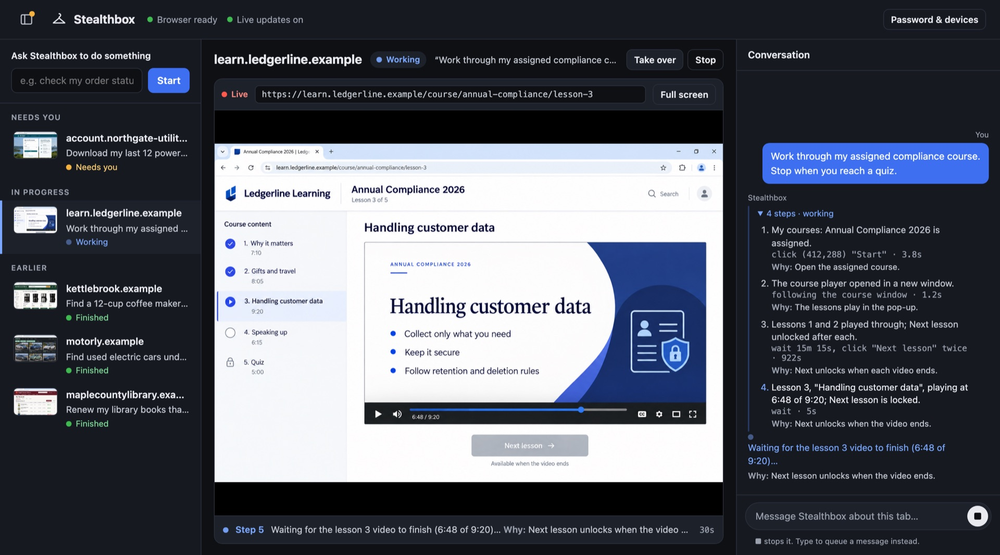
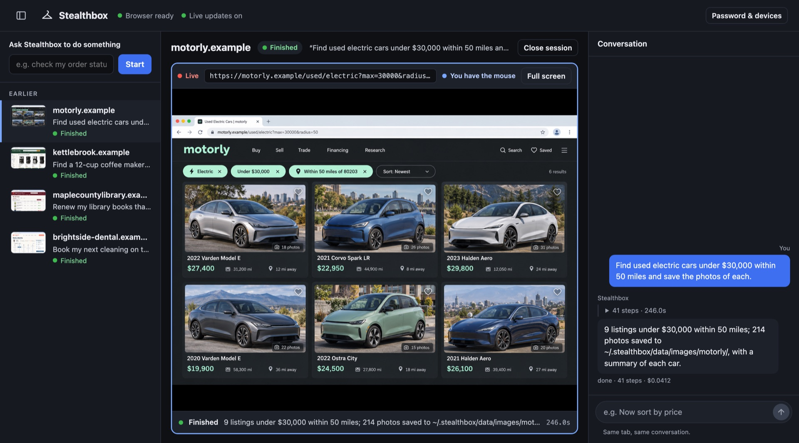
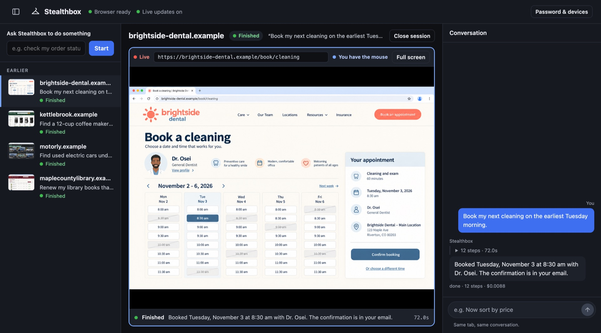
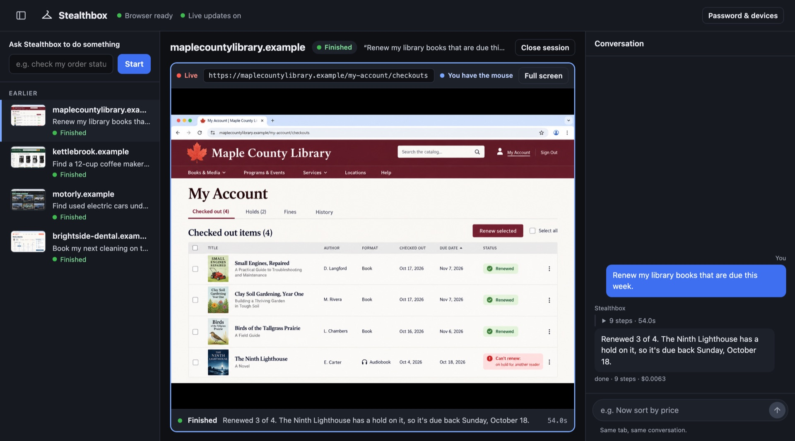
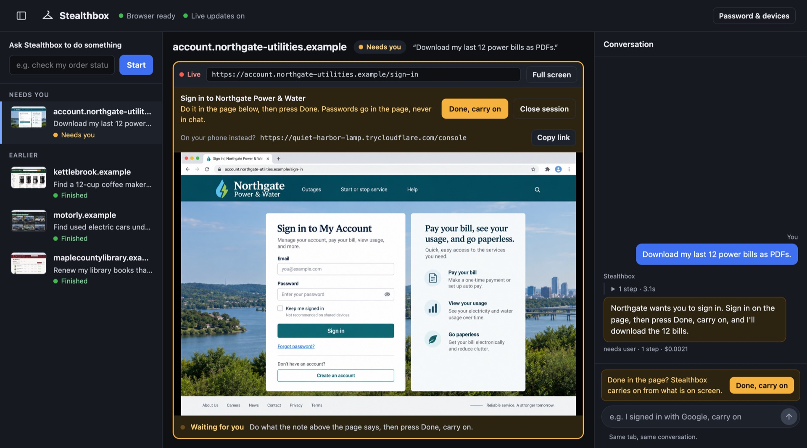

# Stealthbox

A stealth browser for your AI agent. Websites treat it like a person's browser, and it stays logged in. It runs in a box (a Docker container) on your own computer, and you can watch it or take over from your phone.



> **You:** *"With Stealthbox, find a 12-cup coffee maker under $50 with good reviews and put the best one in my cart."*
>
> Stealthbox searches the store, filters to under $50 and 4 stars and up, sorts by rating, and adds the best one to your cart. You can watch every step, and why it took it, in the Stealthbox console.

## What you can hand it

Ask your agent to do things on websites "with Stealthbox". It opens a real browser on your computer, finds its way around each site the way a person would, and tells your agent what it found or did. Some examples, on made-up sites:

<table>
<tr>
<td width="50%" valign="top">


**Training.** *"Work through my assigned compliance course. Stop when you reach a quiz."*

Follows the course player into its pop-up window and waits out each video until **Next** unlocks. Then it hands you the quiz.
</td>
<td width="50%" valign="top">


**Shopping around.** *"Find used electric cars under $30,000 within 50 miles and save the photos of each."*

*9 listings under $30,000 within 50 miles; 214 photos saved, with a summary of each car.*
</td>
</tr>
<tr>
<td width="50%" valign="top">


**Appointments.** *"Book my next cleaning on the earliest Tuesday morning."*

*Booked Tuesday, November 3 at 8:30 am with Dr. Osei. The confirmation is in your email.*
</td>
<td width="50%" valign="top">


**Errands.** *"Renew my library books that are due this week."*

*Renewed 3 of 4. The Ninth Lighthouse has a hold on it, so it's due back Sunday, October 18.*
</td>
</tr>
</table>

And the rest of your list: *"Tell me if Denver to Lisbon in May drops under $700."* *"A table for 4 on Friday at 7, somewhere quiet."* *"Download my last three pay stubs."* Anything you'd do in a browser yourself. It keeps notes on each site it visits, so the next run starts out knowing where things are.

## Watch it, or step in



> **You:** *"Download my last 12 power bills as PDFs."*

When a site needs you, like a sign-in, Stealthbox stops and your agent sends you a link to the console. You sign in on the page from your phone or any computer, tap **Done, carry on**, and it downloads the bills.

The console is a private link behind a password you choose. In it you can:

- see every session and what it's doing right now,
- watch the live browser, type a new address, or take over the mouse,
- sign in to a site yourself, then tap **Done, carry on**,
- send a session a message, or stop it.

## Install

Tell your agent (Claude Code, Codex, Cursor, Grok, and so on):

```text
Install Stealthbox from https://github.com/jonclegg/stealthbox
```

That's it. Your agent will:

1. **Install Stealthbox** on your Mac, Linux, or Windows computer.
2. **Ask before installing Docker**, if your computer doesn't have it yet.
3. **Open a page for your OpenRouter key.** Stealthbox's built-in agent uses it to drive the browser. You paste the key into that page on your own computer, never into the chat. Get one at [openrouter.ai/keys](https://openrouter.ai/keys).
4. **Prove it works.** Your agent asks which two or three sites you use, and Stealthbox visits them the way a person would and shows you a screenshot of each.

## Good to know

- **Sign in yourself.** When a site needs a password, Stealthbox stops and your agent sends you the console link, so you can sign in from your phone or any computer. Don't paste passwords into the chat. Your agent can type in texted sign-in codes for you.
- **It runs on your computer.** Traffic leaves from your own internet connection. Nothing is reachable from outside unless you share the console, and the console asks for your password.
- **The details** for agents and the curious are in [AGENTS.md](AGENTS.md) and [the agent guide](skills/stealthbox/SKILL.md). The browser is Chromium with [Fury](https://github.com/furyteamtop/fury-antidetect-browser)'s fingerprint patches, built for Linux from [`browser/`](browser).

## License

Stealthbox's own code is [MIT licensed](LICENSE). The browser is Chromium (BSD-3-Clause) with Fury's patches (BSD-3-Clause); see [NOTICE](NOTICE) for every component's license. Stealthbox is an independent project, not affiliated with the Fury authors or any website it visits. The sites in this README are made up: the pictures show the real console with illustrated sites in it.
